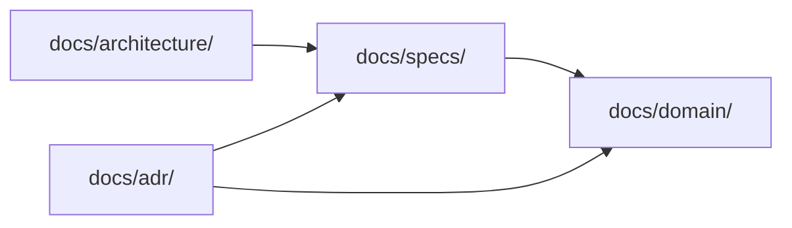

---
paths:
  - 'docs/**'
---

# ドキュメント

`docs/` の書き方を定める。前提として、業務知識とシステム仕様を混ぜない。混ざると、業務のルールが機能ごとに散って再利用できなくなり、実装を作り直したときに業務知識も一緒に失われる。

## 置き場の役割

| 置き場 | 内容 | 文の主語 | 直すとき |
|---|---|---|---|
| `docs/domain/` | 業務がどうなっているか。用語集・業務ルール・未確定事項 | 業務・人・書類 | 上書き |
| `docs/specs/` | システムの振る舞い。共通仕様と機能ごとの受け入れ基準 | システム | 上書き |
| `docs/architecture/` | 技術構成・データモデル・エンドポイント・規約の検査 | システム | 上書き |
| `docs/adr/` | 意思決定の記録 | — | 追記のみ。過去は書き換えない |

作業中のプランは `.claude/plans/` に置き、`docs/` には置かない。

## どこに書くかを決める

```
0. その主題は既にどこかに書かれているか（grep -rn で確かめる）
     ├─ はい → その記述を上書きし、ID は維持する。ここで終了
     └─ いいえ ↓
1. その記述の主語は「システム」か
     ├─ はい → docs/specs/
     └─ いいえ ↓
2. このシステムを別の言語で全面的に作り直しても、その記述は残るか
     ├─ はい → docs/domain/
     └─ いいえ ↓
3. 業務ルールに紐づかない機械的な制約（型・桁数・最大文字数）か
     ├─ はい → マイグレーションに任せる（ドキュメントに書かない）
     └─ いいえ → docs/specs/conventions.md
```

「システムは〜しなければならない」の形で書けてしまったら、それはシステム仕様である。業務ルールの文書にこの形が現れたら境界を越えている（CHK-DOC-01）。

構成そのものの話（どのクラスがその責務を持つか、どのテーブルがその値を持つか）は `docs/architecture/` に置く。振る舞いか構成かで分ける。判断に迷ったら業務知識の側に寄せる。業務知識に書いた仕様寄りの記述は後から移せるが、仕様に埋めた業務知識は上書きのときに一緒に失われる。

ファイル全体が仕様の側に寄っている文書は、記述ごとに削らずファイルごと移す。

## ID

| 対象 | 形式 | 置き場 |
|---|---|---|
| 業務ルール | `BR-SHARED-<連番>` | `docs/domain/shared/business-rules.md` |
| 受け入れ基準 | `AC-<機能>-<連番>` | `docs/specs/conventions.md`・`docs/specs/features/` |
| 意思決定記録 | `ADR-<連番>` | `docs/adr/` |
| 未確定事項 | `Q-<連番>` | `docs/domain/open-questions.md` |

機能の略称と文書の対応は `docs/specs/README.md` に従う。

- 番号は振り直さない。削除したときは欠番のまま空け、なぜ欠番になったかをコメントで残す
- 追加する番号は末尾に続ける。置き場所は主題の合う節の中でよく、番号順に並ばなくてもよい
- 既存の主題を書き直すときは、新しい ID を振らずにその記述を上書きする。ID が指すのは主題であり、そのときの記述ではない
- 業務領域を分けて文書を移したときも、`BR-SHARED-` の接頭辞と番号はそのまま維持する
- 存在しない ID を参照しない（CHK-DOC-04）

## 参照の向き



業務知識から仕様と構成を参照しない（CHK-DOC-02）。逆参照を持たせると、仕様を変えるたびに業務知識の側も直すことになる。例外は `docs/domain/open-questions.md` の影響範囲欄だけである。どの業務ルールがどこで実現されているかは、`grep -rn 'BR-SHARED-006' docs/` のように検索で追う。

## 実装の名前を出す範囲

ドキュメントは業務側との共有にも使う。クラス名・テーブル名・カラム名・ファイルパスは、`docs/architecture/` と `docs/adr/` にだけ出す。`docs/domain/` には出さない（CHK-DOC-03）。`docs/specs/` には出さず、エンドポイントの入力項目の名前だけは必要な範囲で使う。

## 用語と文体

用語は `docs/domain/shared/glossary.md` を唯一の正とする。次の表記を揺らさず、言い換えや併記をしない（CHK-DOC-09）。受講状況と学習履歴を混同しない。

| 使う | 使わない |
|---|---|
| 講座 | コース |
| チャプター | 章・セクション |
| レッスン | 単元 |
| 受講状況 | 学習進捗・出席状況 |
| 受講生 | 生徒・ユーザー |
| マネージャー | 管理者 |

- である調で書く。一度読んで意味が取れる、簡潔な説明にする
- 太字記法と区切り線を使わない。強調は見出しと表で表す（CHK-DOC-07）
- 説明の地の文でコロンを使わない（コード・表のセル・mermaid の構文の中はよい）
- 図は mermaid で描く。状態の遷移は必ず mermaid で表す
- マークダウンで一系統に管理する。同じ内容の HTML や別形式の文書を作らない
- 版を分けたファイル（`*_v2.md`・`*_old.md`・`*_20260817.md`）を作らない。状態を表す文書は上書きし、履歴は Git に任せる（CHK-DOC-08）

## コードとの二重管理を避ける

| 何を正とするか | 対象 |
|---|---|
| ドキュメント | 業務判断が入るもの（権限による見え方、検索の仕様、状態の遷移、絞り込みの既定値、業務ルールから導かれる必須） |
| マイグレーション | 業務ルールに紐づかない機械的な制約（型・桁数・単なる入力必須）。`docs/architecture/data-model.md` にはカラムの意味と関連だけを書く |
| Resource | 応答に含める項目の一覧 |
| `.ai/rules` | コードとドキュメントの書き方の規約 |
| `CLAUDE.md` | 進め方、実装前に押さえる注意点、よく使うコマンド |

## 実装が終わったとき

まず、その主題がすでにどこに書かれているかを検索で確かめる。既存の記述があれば ID を維持して上書きし、新しい主題のときだけ新しい番号を末尾に続ける。足すことから入ると、同じ振る舞いが2つの ID で並ぶ。

そのうえで、同じ変更のなかで次を更新する。

| 変更内容 | 更新するファイル |
|---|---|
| 振る舞いを変えた | `docs/specs/features/<機能>.md`（上書き） |
| 全エンドポイントに共通する扱いを変えた | `docs/specs/conventions.md`（上書き） |
| データ構造を変えた | `docs/architecture/data-model.md`（上書き） |
| エンドポイントを追加・変更した | `docs/architecture/api.md`（上書き） |
| 実装の構成を変えた | `docs/architecture/overview.md`（上書き） |
| 規約を変えた | `.ai/rules/` の該当ファイルと `docs/architecture/convention-checks.md`（上書き） |
| 業務ルールが判明・変更された | `docs/domain/shared/business-rules.md`（上書き） |
| 未確定のまま進める点がある | `docs/domain/open-questions.md` に `Q-NNN` を追加し、コードに `TODO(Q-NNN)` を残す |
| 技術選定の判断をした | `docs/adr/` に新しい記録を追加（既存は上書きしない） |
| 方針を覆した | 旧記録のステータスだけを更新し、新しい記録を追加 |

本文を直したら、同じファイルの図が古いまま残っていないかを見る。受け入れ基準だけ直して図を放置すると、次に読む人は図のほうを信じる。不要になった文書は残さず削除する。

## 点検

構成を整理・レビューするときは、機械で見つけられるものから当てる。

```bash
# 業務ルールにシステムを主語にした文が混ざっていないか（0 件であるべき）
grep -rn 'システムは.*しなければ\|してはならない' docs/domain/

# 業務知識から仕様・構成への参照がないか（open-questions と、置き場を説明している行を除いて 0 件であるべき）
grep -rn 'docs/specs/\|docs/architecture/' docs/domain/ | grep -v open-questions

# 業務知識にテーブル名・カラム名が出ていないか（ヒットしたら業務の語彙かどうかを確かめる）
grep -rn '`[a-z][a-z_]*_[a-z_]*`' docs/domain/
```
